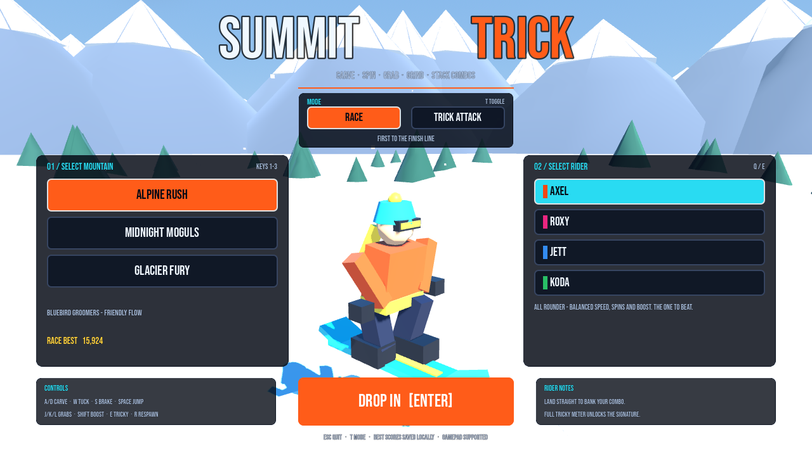
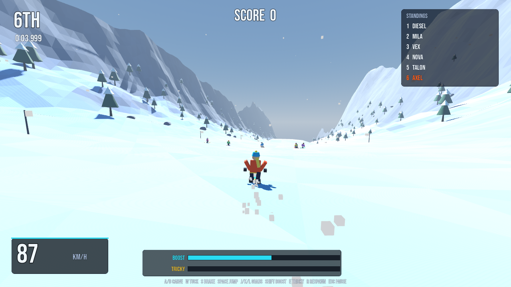
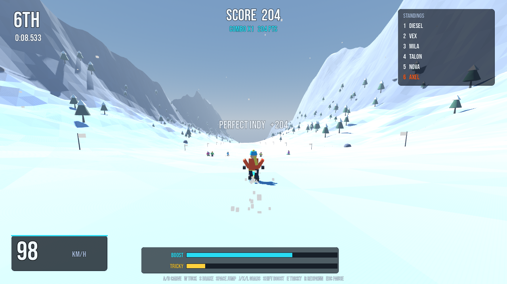
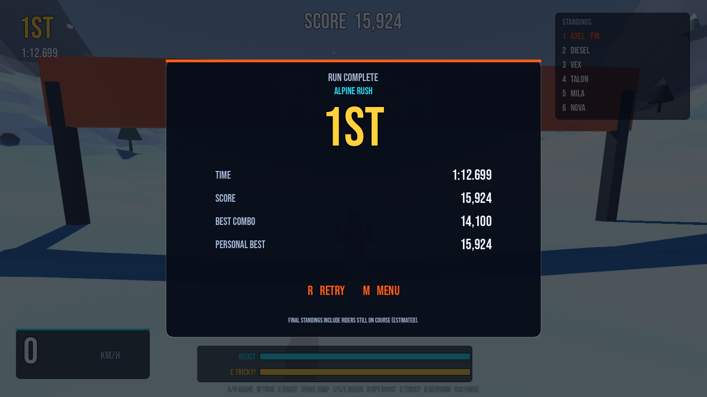
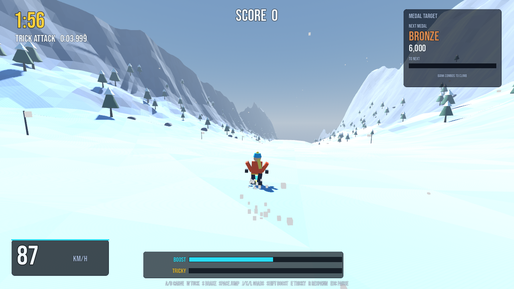
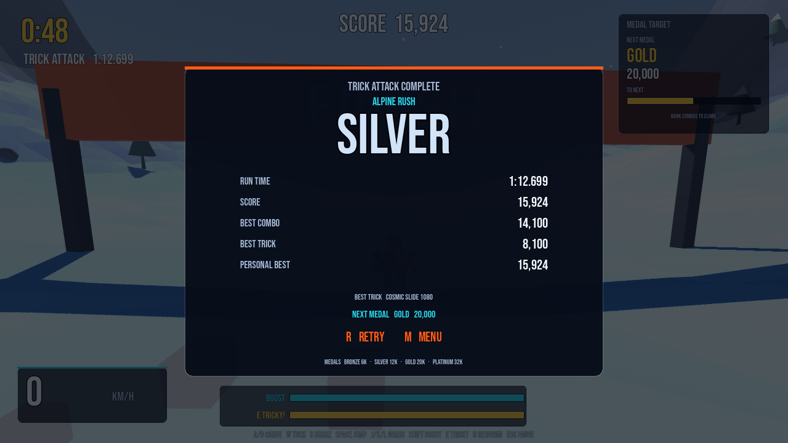

# SUMMIT TRICK

A low-poly, SSX Tricky-flavoured snowboard game built entirely in **Godot 4**.
Three procedurally generated mountains, five rival riders, two modes, big
kickers, grindable rails, spins, flips, grabs, combo banking and a Tricky meter
with signature tricks.


## Screenshots













## Run it

1. Install **Godot 4.4 or newer** (standard build, no C# needed).
2. Open `project.godot` in the Godot editor.
3. Press **F5**.

From a terminal you can also run it directly:

```bash
godot --path .
```

The 3D world is generated at runtime — there are no imported 3D models or
textures. Audio combines synthesized SFX (`tools/gen_audio.py`) with three CC0
music tracks (see `THIRD_PARTY_AUDIO.md`); the display font is OFL Bebas Neue.

## Controls

| Action | Keyboard | Gamepad |
| --- | --- | --- |
| Carve | `A` / `D` or `←` / `→` | Left stick |
| Tuck (speed) | `W` / `↑` | Left trigger |
| Brake | `S` / `↓` | — |
| Jump / ollie / pop off rail | `Space` | A |
| Boost | `Shift` | Right trigger |
| Grabs | `J` / `K` / `L` | X / Y / RB |
| Signature trick (Tricky full) | `E` | LB |
| Respawn | `R` | Back |
| Pause | `Esc` | Start |
| Mute | `N` | — |

In the air: `A`/`D` spin, `W`/`S` flip. Land with your board straight (or after
a full rotation) to keep the combo alive. `R` after a run retries, `M` returns
to the menu.

Menu: mouse, `T` to switch between Race and Trick Attack, `1`–`3` for
mountains, `Q`/`E` for riders, `Enter` to drop in. The **AUDIO / MUSIC
VOLUME** slider adjusts the soundtrack in real time and is saved to
`user://summit_trick.cfg` with your other settings.

## How the game works

### Mountains are pure math

`scripts/course.gd` defines a heightfield:

* a downhill base profile with rollers,
* a curved centre line and a wide half-pipe valley that keeps you near the
  race line,
* off-piste noise and distant ridge walls,
* asymmetric kicker ramps with hard lips.

The terrain mesh, the rider physics, prop placement and AI all sample the same
`height(x, z)` function, so the visuals and the ride are perfectly in sync. The
mesh is built in chunks with flat-shaded, vertex-coloured triangles for the
low-poly look.

### Riding model

`scripts/player.gd` is an arcade controller (no rigid bodies): gravity is
projected onto the snow normal, carving scrubs speed, tucking adds speed and
reduces drag, and leaving a kicker lip converts the terrain's vertical rise into
launch velocity. Air state tracks spin/flip angles and grab hold times; landing
alignment decides between a clean trick and a crash.

* **Combos** – each landed trick raises the multiplier; the combo banks after
  7 seconds or on the next clean landing chain, and is lost on a bail.
* **Boost** – earned from tricks, spent with `Shift`.
* **Tricky meter** – fills with trick points. At 100%, press `E` in the air for
  a guaranteed-clean signature 1080 worth 6,000 base points.
* **Rails** – jump onto the glowing rails and you lock in; `Space` pops off.
  Grind distance converts to points.
* **Tweaked tricks** – hold a grab for 0.8 seconds through a spin or flip for a
  `TWEAKED` 18% bonus. Your best single trick appears on the results screen.

### Trick Attack

The mode switch on the title screen adds a second way to play. Trick Attack
removes the rivals, puts a two-minute cap on the run and scores it purely on
tricks. Medals are awarded at 6,000 (Bronze), 12,000 (Silver), 20,000 (Gold)
and 32,000 (Platinum). The HUD tracks the next target while you ride; the
results screen shows your medal, best combo, best trick and personal best.
Race and Trick Attack bests are saved separately for each mountain.

### Rivals

In Race mode, `scripts/rival.gd` riders follow the course, jump kickers and
throw stylish spins, with gentle rubber-banding so the pack stays close. Final
standings are computed from finish times (riders still on course get an
estimated time).

### Menus, HUD and audio

* `scripts/menu.gd` — title screen with mode toggle, mountain/rider selection,
  per-mode saved bests and the saved music-volume slider.
* `scripts/menu_vista.gd` — the 3D diorama behind the menu, with the selected
  rider rotating on a snow mound.
* `scripts/hud.gd` — placement or Trick Attack countdown/medal target, score,
  combo, meters, trick popups, standings, pause and both results layouts.
* `scripts/audio_director.gd` — menu/race/Trick Attack music with crossfades,
  speed-reactive wind and synthesized SFX.
* `THIRD_PARTY_AUDIO.md` — source and license details for the CC0 tracks.
* `scripts/game.gd` — mode orchestration, countdown, standings, medals, saves.

## Project layout

```
project.godot
scenes/main.tscn
scripts/
  game.gd            race/trick orchestration, medals, saves
  course.gd          heightfield + course/theme definitions
  world.gd           terrain chunks, forest, rocks, flags, gates, rails, snow
  player.gd          arcade boarding, air tricks, grinding, tweaked landings
  rival.gd           AI riders
  rider_model.gd     procedural low-poly snowboarder
  camera_rig.gd      chase camera
  hud.gd             in-race UI
  menu.gd            title screen
  menu_vista.gd      animated 3D menu backdrop
  audio_director.gd  audio playback and mixing
  ui_kit.gd          shared UI helpers
  rider_defs.gd      playable and rival rider data
audio/               CC0 music + synthesized WAVs/SFX
fonts/               Bebas Neue (SIL Open Font License)
tools/gen_audio.py   regenerates SFX and fallback music
```

## Tuning

* Course layout, kicker/rail placement and palettes: `Course.course_defs()` and
  `Course.get_theme()` in `scripts/course.gd`.
* Rider stats: `scripts/rider_defs.gd`.
* Physics, trick scoring, combo timers and meters: constants and `_land()` in
  `scripts/player.gd`.
* Trick Attack timer and medal thresholds: `TRICK_TIME` and `trick_medals` in
  `scripts/game.gd`.
* Rival pace: `speed` values in `rider_defs.gd` (28–30 works well against a
  clean player run).

## Verification

Validated with **Godot 4.7.2** in this build environment, both headlessly and
with a software-rendered X display (Xvfb + Mesa llvmpipe).

Autopilot race tests ride every course from the countdown to the results screen,
including jumps, grabs, a signature trick, combo banking and the final
standings:

```bash
godot --headless --path . --fixed-fps 60 --auto-race --mode=race --course=0
godot --headless --path . --fixed-fps 60 --auto-race --mode=race --course=1
godot --headless --path . --fixed-fps 60 --auto-race --mode=race --course=2
godot --headless --path . --fixed-fps 60 --auto-race --mode=trick --course=0
```

| Course | Finish time | Score | Place |
| --- | --- | --- | --- |
| Alpine Rush | 1:12.63 | 15,924 | 1st / 6 |
| Midnight Moguls | 1:17.02 | 8,135 | 1st / 6 |
| Glacier Fury | 1:23.28 | 13,674 | 1st / 6 |

A Trick Attack autopilot run on Alpine Rush finished in 1:12.63 with 15,924
points and a Silver medal. A temporary five-second timer build also reached the
results screen with a 0-point "SEND IT" result, covering the timeout path.

All scripts compile without errors. The title screen/mode selector, race HUD,
air/trick popups, Trick Attack HUD and both results layouts were visually
checked from the screenshots in `docs/`. The three music streams load at
66.93s, 201.46s and 75.91s and report `loop=true`; menu, race and Trick Attack
transitions ran without errors. A headless settings check verified the slider
signal, the dedicated Music bus gain and a save/load round-trip for the volume.
The Gamepad and keyboard bindings are configured in code; the screenshots were
taken with the autopilot enabled.

**Not verified here:** how the CC0 tracks sound in the mix and their timing
against gameplay (the build machine had no audio device, so Godot used its
dummy driver), the feel of human input on physical hardware, and Trick Attack
medal pacing with a human rider. Open the project in the editor, press F5 and
judge those directly.

## Credits

* Font: [Bebas Neue](https://github.com/google/fonts/tree/main/ofl/bebasneue)
  by Ryoichi Tsunekawa, SIL Open Font License (`fonts/OFL.txt`).
* Music: "Menu Music" by wipics, "Black Diamond" by Joth and "Donuordame" by
  Sudocolon — all CC0. See `THIRD_PARTY_AUDIO.md`.
* Sound effects and fallback music are synthesized by `tools/gen_audio.py`.
* Everything else is procedural GDScript.
